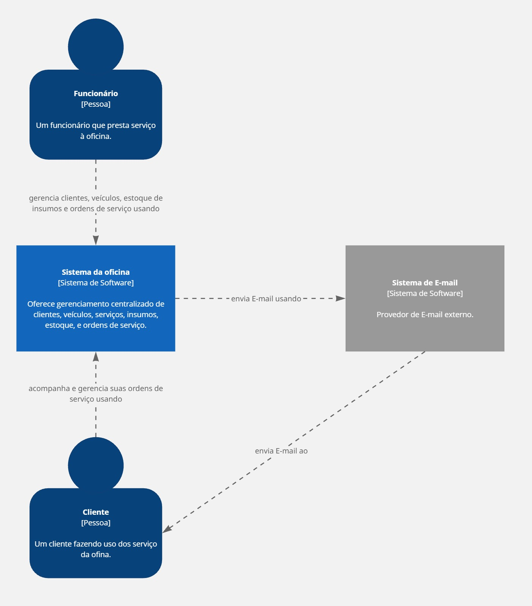
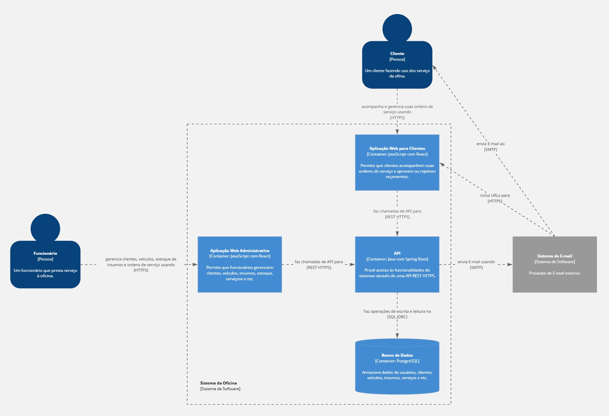
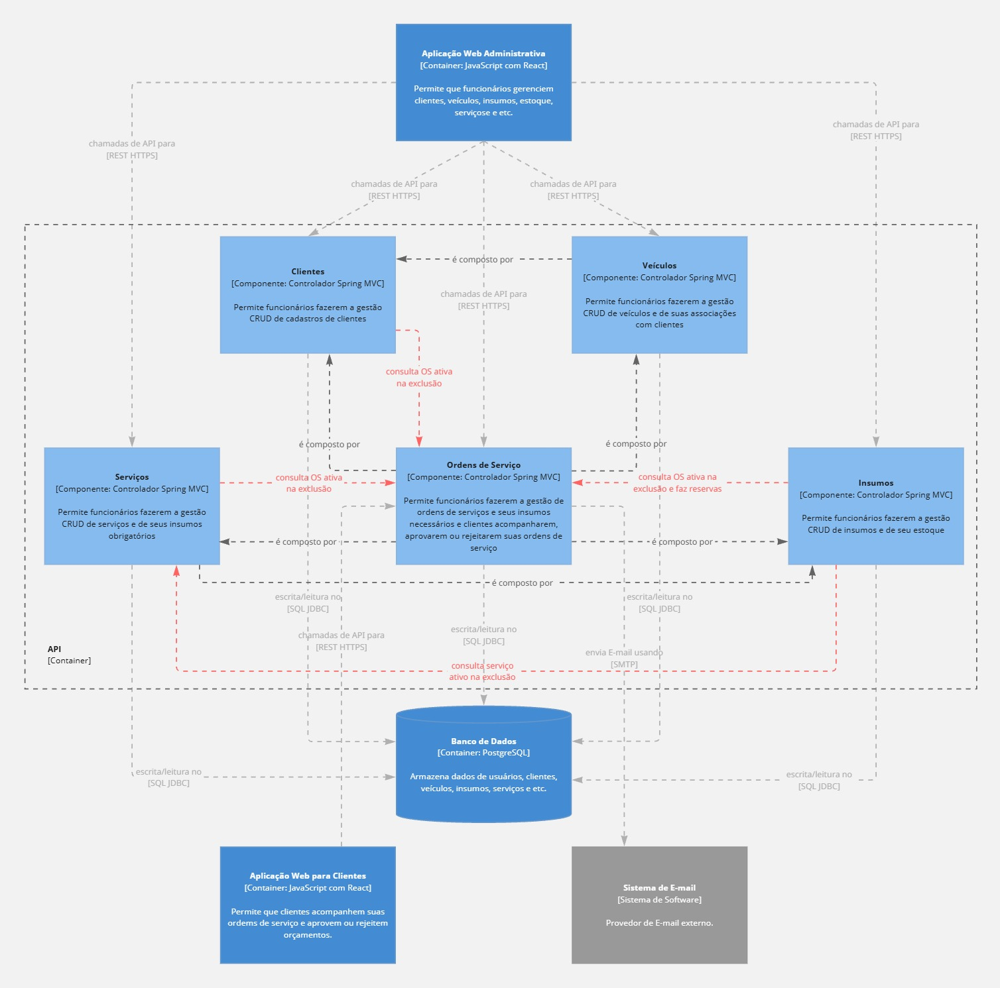
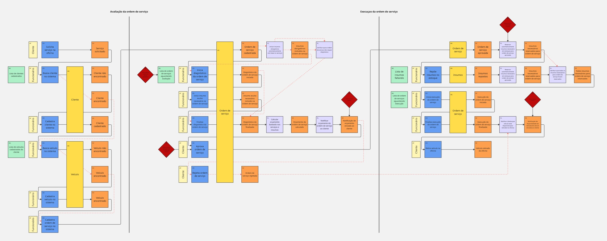

# Design Approval Sheet

- **Projeto:** Oficina
- **Versão:** 1.0.0

## Linguagem ubíquoa

O dicionário da linguagem ubíquoa utilizada por esse projeto pode ser encontrada em [/doc/GLOSSARY.md](/doc/GLOSSARY.md).

## Requisitos

### Requisitos funcionais

Os requisitos funcionais do sistema foram descritos em [/src/bdd/resources/features/](/src/bdd/resources/features/)
utilizando Gherkin e práticas de BDD com validação automática.

### Requisitos não funcionais

#### Desempenho e capacidade

- Responder às operações usuais em até 2 segundos em 95% dos casos.
- Suportar o acesso simultâneo de funcionários e clientes sem prejudicar o atendimento.

#### Disponibilidade

- Garantir disponibilidade mensal mínima de 99,5% durante o expediente.
- Realizar manutenções programadas fora do horário de atendimento.

#### Segurança e privacidade

- Restringir o acesso aos dados conforme o perfil e o vínculo do usuário.
- Proteger dados pessoais e credenciais no armazenamento e na comunicação.

#### Confiabilidade e recuperação

- Manter a consistência dos dados em acessos simultâneos e falhas de operação.

#### Rastreabilidade e monitoramento

- Registrar responsável, data e alterações relevantes para o negócio.
- Monitorar falhas e indisponibilidade para agilizar a identificação de problemas.

#### Manutenibilidade

- Validar fluxos com testes automatizados com cobertura mínima de 80% e ideal de 100%.

## Decisões de arquitetura

O histórico de decisões de arquitetura do projeto pode ser encontrado em [/doc/adr/](/doc/adr/).

## Modelo C4

### Context

### Containers

### Components

> **Nota:** Nesse MVP, as dependências entre componentes não ficaram muito limpas. Existem diversos ciclos de
> dependências. No diagrama, dependências "indesejadas" foram representadas em vermelho.

### Code

Esse projeto não contém diagramas para o nível de "Code" do C4. O código pode ser encontrado em
[/src/main/java/com/oficina/api/](/src/main/java/com/oficina/api/).

## Event Storming

