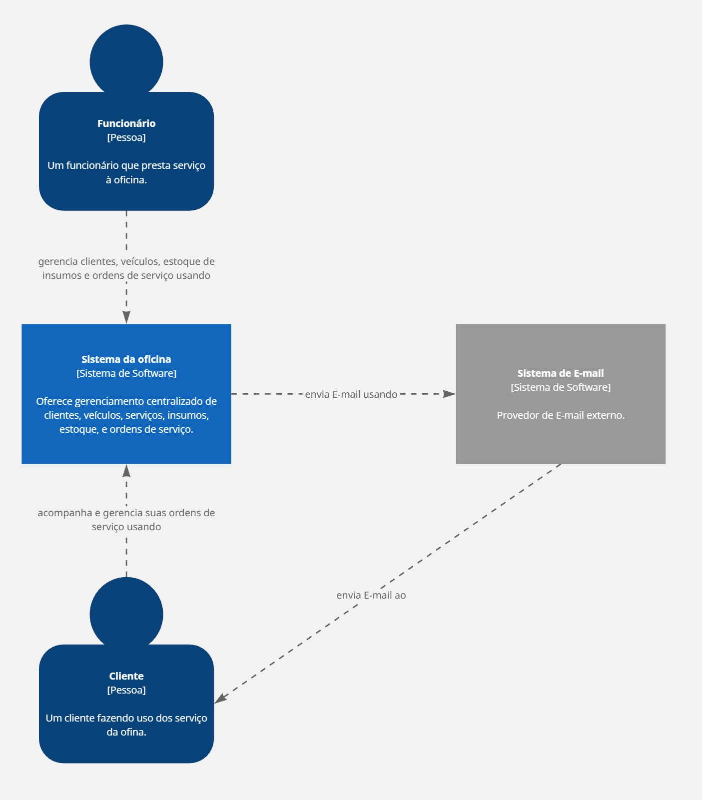
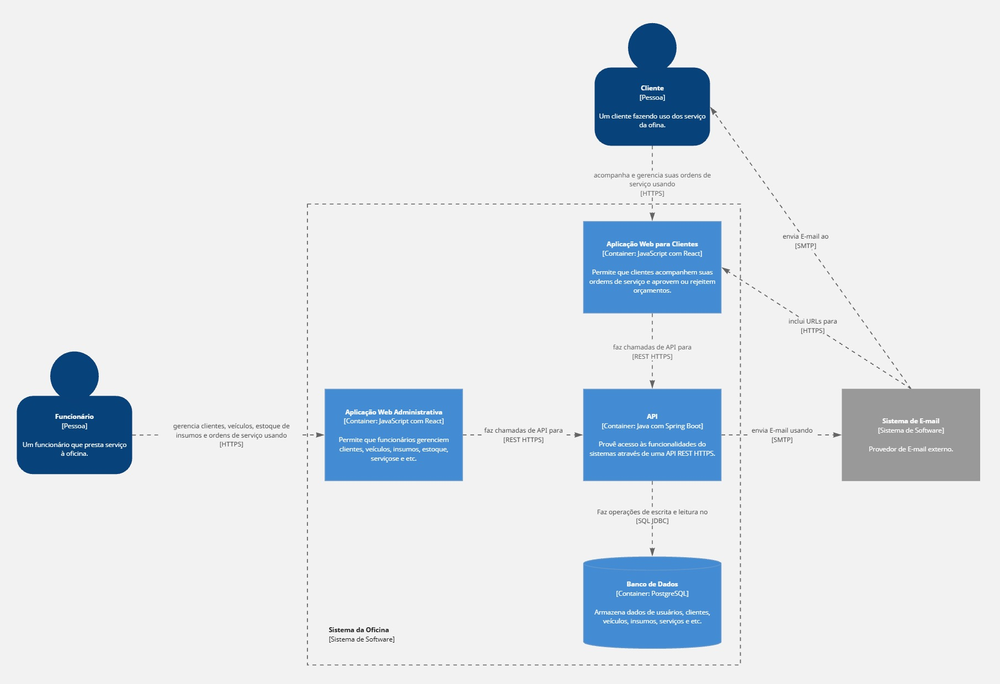
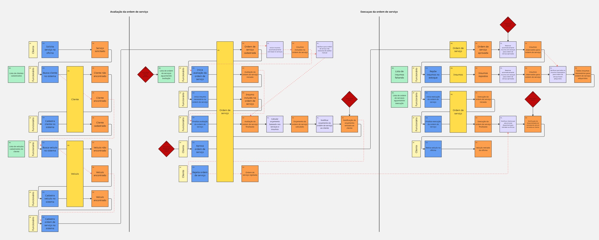

# Design Approval Sheet

- **Projeto:** Oficina
- **Versão:** 1.0.0

## Modelo C4

### Context

### Containers

### Components

TODO

### Code

Esse projeto não contém um diagrama para o nível de Code do C4.

## Event Storming

